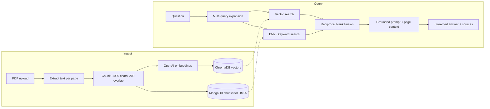

# AI PDF Chat

Chat with any PDF and get answers that are grounded in the document, with page-level citations. It also includes an AI resume analyzer that compares a resume against a job description.

Built with a hybrid retrieval pipeline (semantic vector search + BM25 keyword search, merged with Reciprocal Rank Fusion), multi-query expansion, and streaming answers.

---

## Features

### PDF Chat
- **Upload and summarize:** upload a PDF (up to 25 MB) and get an instant 2-3 sentence summary.
- **Grounded answers only:** the model answers strictly from retrieved passages and never from outside knowledge. If the PDF doesn't contain the answer, it says so instead of guessing.
- **Page citations:** every answer comes with source cards showing the page number and the exact text chunk used.
- **Streaming responses:** answers appear token by token over Server-Sent Events.

### Resume Analyzer
- Upload a resume PDF and provide a job description (paste text or upload a PDF).
- Returns a structured analysis: overall score, ATS-style keyword score, match percentage, strengths and weaknesses, matched and missing skills, experience/education/project feedback, a rewritten professional summary, a hiring recommendation, and 5-10 tailored interview questions.
- Scores are AI estimates for guidance, not results from a real ATS.

---

## How the RAG Pipeline Works



| Step | What it does |
|------|--------------|
| **Chunking** | Text is extracted page by page and split with `RecursiveCharacterTextSplitter` (1000 characters, 200 overlap). Each chunk keeps its page number, chunk index, and document ID for citations. |
| **Embeddings** | OpenAI `text-embedding-3-small`, stored in ChromaDB through a custom LangChain `VectorStore` wrapper. |
| **Hybrid retrieval** | Each query runs semantic vector search and BM25 keyword search in parallel. Semantic search finds meaning; BM25 catches exact terms like names, numbers, and codes. |
| **Rank fusion** | Both result lists are merged with weighted Reciprocal Rank Fusion and deduplicated. |
| **Multi-query** | An LLM rewrites each question into several variants to improve recall on vague or differently worded questions. |
| **Hallucination guard** | The prompt forces answers from context only. The model returns sentinel tokens for "not found" and "unrelated question", which the server converts into clear fallback messages. |
| **Streaming** | Answers stream over SSE with `metadata`, `token`, `done`, and `error` events. The server buffers the first tokens to detect the sentinel before showing anything to the user. |

---

## Tech Stack

| Layer | Technologies |
|-------|--------------|
| Frontend | React 18, Vite, Tailwind CSS, React Router, Framer Motion, react-markdown |
| Backend | Node.js, Express, LangChain JS, Multer, pdf-parse |
| AI | OpenAI (`gpt-4o-mini`, `text-embedding-3-small`) |
| Data | ChromaDB (vectors), MongoDB with Mongoose (BM25 chunk index) |

---

## Project Structure

```
Pdf_chat/
├── frontend/
│   └── src/
│       ├── pages/            # PDFChat, ResumeAnalyzer
│       ├── components/       # chat, dashboard, layout, modals
│       └── services/api.js   # REST client + SSE stream reader
└── backend/
    └── src/
        ├── server.js
        ├── routes/           # /api (PDF chat), /api/resume
        ├── controllers/      # upload, chat (SSE), resume
        ├── services/
        │   ├── pdfService.js           # parsing + chunking
        │   ├── ragService.js           # retrieval, prompts, streaming
        │   ├── hybridSearchService.js  # BM25 + vector + RRF
        │   └── resume.service.js       # resume analysis
        ├── config/           # ChromaDB store, MongoDB connection
        ├── models/           # BM25 chunk model
        ├── prompts/          # resume analysis prompt
        ├── validators/       # request validation
        └── middlewares/      # upload and error handling
```

---

## API

| Method | Endpoint | Description |
|--------|----------|-------------|
| `GET` | `/api` | Service status |
| `POST` | `/api/upload` | Upload a PDF (multipart field `pdf`). Returns `docId`, page count, chunk count, and summary. |
| `POST` | `/api/chat` | Body: `{ docId, question }`. Responds with an SSE stream. |
| `POST` | `/api/resume/analyze` | Multipart fields `resume` (PDF) and either `jobDescription` (text) or `jdFile` (PDF). Returns the JSON analysis. |

---

## Getting Started

### Prerequisites
- Node.js 20+
- An OpenAI API key
- A MongoDB database (local or Atlas)
- A running ChromaDB server (`pip install chromadb`)

### 1. Clone and configure

```bash
git clone https://github.com/lenin-12/<your-repo-name>.git
cd <your-repo-name>
```

Backend (`backend/.env`):

| Variable | Purpose |
|----------|---------|
| `PORT` | API port (default 5002) |
| `OPENAI_API_KEY` | Chat, summaries, embeddings, resume analysis |
| `MONGODB_URI` | MongoDB connection string for the BM25 index |
| `CHROMA_URL` | ChromaDB server URL (default `http://localhost:8000`) |
| `FINAL_CONTEXT_K` | Chunks retrieved per search (default 5) |

Frontend (`frontend/.env`):

```env
VITE_API_URL=http://localhost:5002
```

### 2. Run

```bash
# Terminal 1: vector database
cd backend
npm install
npm run chroma

# Terminal 2: API
cd backend
npm run dev

# Terminal 3: frontend
cd frontend
npm install
npm run dev               # http://localhost:5173
```

Without a valid `OPENAI_API_KEY`, the app starts in a limited demo mode that uses simple keyword matching instead of the AI pipeline.

---

## Limitations and Roadmap

- Only PDFs with selectable text are supported. Scanned or image-only PDFs need OCR, which is not included yet.
- No user accounts yet. Documents are identified by a random ID.
- Planned: OCR for scanned PDFs, saved chat history, and a retrieval-quality evaluation set.

---

## Author

**Lenin** — [GitHub](https://github.com/lenin-12)
